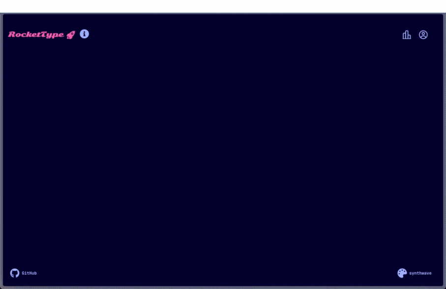
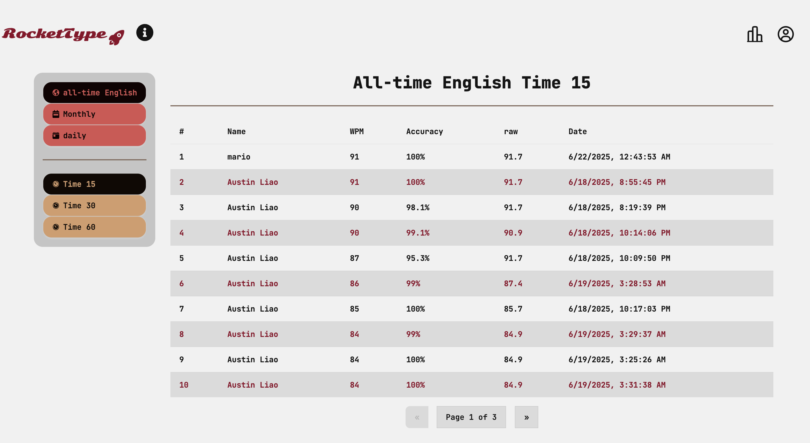
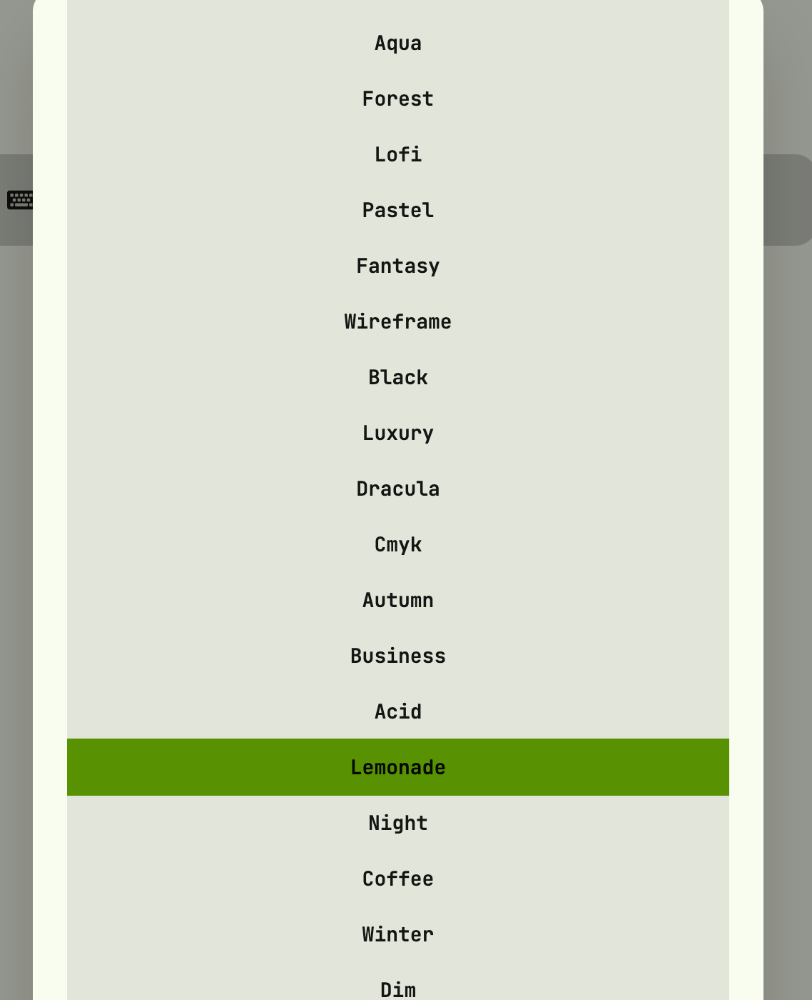
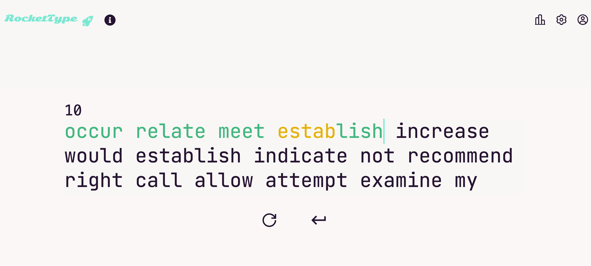
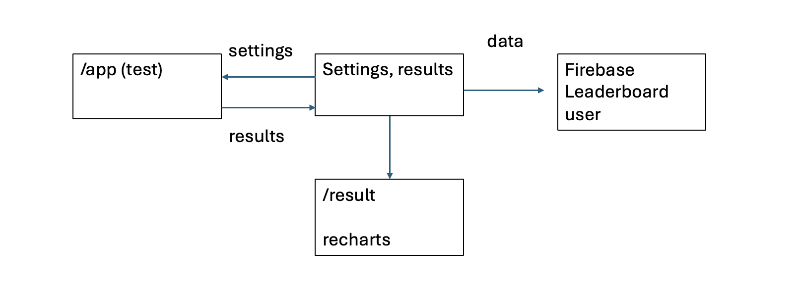
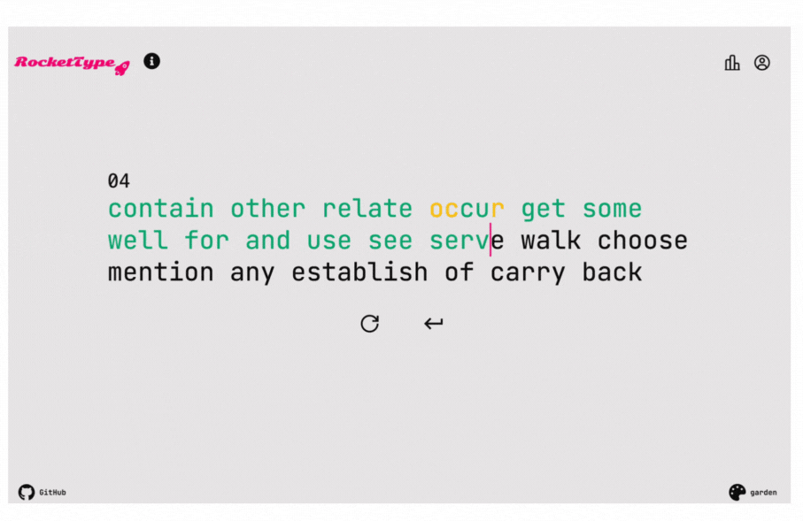

## Welcome to Your Next Galactic Adventure!


**Rocket Type** is a minimalistic typing app designed to help you improve your speed and accuracy while having fun! Compete for the top spot, track your progress, and blast off your typing skills to new heights.


## Give it a try here!
**[Live Demo](https://celestial-scribes.vercel.app)**

## 🚩 Features

- Multiple typing modes: Timed, Word Count, and free mode
- Clean, distraction-free interface
- Real-time stats: WPM, accuracy, errors, raw speed
- Leaderboards & personal progress tracking
- Color Themes Support (35 themes)
- Animated visual feedback and fun graphics


## ⌨ User Guide
- Select your settings and get ready to type! <br>

- Track your scores with detailed stats!

- See how you stack up against other players on the leaderboard

- Want a different look? Choose from 35 color themes and find one that suit your fancy!


## 🖥️ Tech Stack

#### Front-end
- React
    - Custom Hooks
- Next.js
- Tailwind
- Motion


#### Back-end and Database
- Vercel
- Firestore


#### UI/UX
- DaisyUI
- shadcn/ui
- Recharts
- React-icons




## Development Details

- The test settings, current test results, and login state are managed by a custom hook. Certain settings are only visible in certain game modes. 
- Once a test is completed, the result in the custom hook will be sent to the Firestore database via an async function.





## "Controlled" Auto Scrolling
To keep the caret (the current input position) always in the middle of the viewport—the second line in a three-line layout—I used a combination of the useEffect and useRef hooks to achieve the desired effect.


``` JavaScript
 useEffect(() => {
      if (!containerRef.current || !currentCharRef.current) return;

      //useRef hooks to track the position of the caret and its parent container
      const container = containerRef.current; 
      const currentChar = currentCharRef.current;

      const lineHeight = 60;
      // the distance between the current position and the top of the container
      const caretLine = Math.round(currentChar.offsetTop / lineHeight);
    
      if (caretLine < 2) {
        // if the caret is on the first or second line, no scrolling is required.
        container.scrollTop = 0;
      } else {
        // When the caret enters the third line, the scrollTop method will be triggered. Therefore, always keeping three lines of text visible.
        container.scrollTop = (caretLine - 1) * lineHeight;
      }
    }, [userInput]);
```

## 📧 Contact
- My name is Austin Liao (廖祥廷). I am a front-end developer based in Taiwan. You can reach me via one of the methods below. Come and say hi!
- [E-mail](austin.ht.liao@gmail.com)
- [LinkedIn](https://www.linkedin.com/in/hsiang-ting-liao/)


## Development and verification

Run `npm run dev` for development, `npm test` for the focused domain tests,
`npm run lint` for ESLint, and `npm run build` for the production build.
The tests use Node’s built-in test runner and the installed TypeScript compiler;
no additional test package is required.

### Scoring and history

Scoring version 2 calculates WPM from correct letters still present in the text,
plus separators after fully correct submitted words. Deleted and retyped letters
do not earn additional WPM. Accuracy retains all attempted mistakes; overall raw
speed uses total character/space keystrokes divided by the actual test duration.
Timers use the elapsed clock and reject input after the deadline.

New results store `scoringVersion`, `elapsedSeconds`, `testKind`, and character
counts. Old results remain visible as “Legacy” in history. They are excluded from
current personal bests, progress comparisons, and rankings because their saved
counters cannot reconstruct the new score or actual word-count-test duration.
Recorded lifetime typing time excludes unknown legacy durations.

Missed-word practice includes corrected mistakes and runs with a fixed word list.
Practice is labeled and excluded from standard personal bests and rankings.
Leaderboard periods use UTC; ties use accuracy, then earliest completion, then
result ID. Each player occupies one position per selected configuration.

### Durable result recovery

Completed tests use a stable result ID. Failed saves reappear after navigation,
refresh, or reopening the site; use “Retry saving” with the original account.
Clearing browser data removes pending results. If storage is unavailable, keep
the tab open and retry. With verified tests enabled, recovery also stores the
scored test’s typing events until acknowledgement; Zen text is never saved.

Account forms await completion and preserve input after errors. Browser resets
wait for active saves and cancel old retries across tabs using Web Locks (HTTPS
or localhost). IME text commits once. Zen respects live reduced-motion changes.

### Current production configuration

Project: `typing-app-566de`. Billing is currently disabled. `firebase.json`
deploys `firestore.compat.rules`: result owners can create bounded unverified
scores, retry an identical write, and delete their own results. Score edits,
other-account writes/deletes, fabricated verification, and access to backend
collections are denied. Existing public score reads remain available during
this compatibility stage. These rules do not make client-submitted scores
trustworthy. The index file preserves previously deployed indexes and adds the
history and filtered leaderboard queries, including verified-score queries.

```sh
npx firebase deploy --only firestore:rules,firestore:indexes --project typing-app-566de
```

The production indexes and compatibility rules have been deployed. All-time,
daily, and verified leaderboard queries were checked read-only against the live
project. No production accounts or results were created or deleted for tests.

### Server verification and account cleanup

`functions/` contains authenticated callable functions and an Auth deletion
trigger. Functions use Node.js 22. Their build copies the app’s pure scoring
engine and word dictionaries so browser and server use the same scoring rules.

For verified tests, the server issues the word list and starts its clock on the
first input request. Submission replays bounded, ordered input events and ignores
client scores and ownership claims. Result IDs match server-issued test IDs;
identical retries return the existing result, while changed replays are rejected.
Timed results use the configured duration; word-count and practice results use
server-observed elapsed time, which can include network delay. The result page
shows the confirmed metrics after saving. Supported limits are 20,000 events,
500 WPM and 1,500 raw WPM. This verifies scoring and session ownership; it does
not prove that a human typed the input or prevent bots.

Only verified standard timed scores qualify for public rankings after cutover.
Older pending results can be imported as unverified private history. Previous
results retain their history labels; they are not retroactively verified.

Server reset advances an account generation before cleanup, rejecting older
sessions across devices. Cleanup deletes owned results and sessions in batches
of 400 and is retryable. Auth deletion triggers the same cleanup independently
of the browser and leaves a tombstone to block old sessions. Never use bulk
Admin `deleteUsers` for this workflow: Firebase does not emit those deletion
triggers. Expired test sessions use a seven-day TTL after server deployment.

### Backend rollout (billing required)

Cloud Functions deployment requires the Firebase Blaze plan. Billing has not
been enabled or changed. Keep `NEXT_PUBLIC_VERIFIED_RESULTS` unset until the
backend is deployed and the frontend rollout is ready. Existing account deletion
removes sign-in only until the cleanup function is live.

1. Enable Blaze for the intended project in the Firebase console and review
   billing alerts. Functions have zero minimum instances and bounded maximum
   instances; those limits are not a spending cap.
2. Install the backend dependencies and deploy only this codebase and indexes:

   ```sh
   npm ci --prefix functions
   npx firebase deploy --config firebase.server.json --only functions:rockettype,firestore:indexes --project typing-app-566de
   ```

3. Set `NEXT_PUBLIC_VERIFIED_RESULTS=true` in the frontend deployment environment
   and rebuild/redeploy the frontend. It must use the same Firebase project.
4. Deploy the strict server-only rules after the updated frontend is available:

   ```sh
   npx firebase deploy --config firebase.server.json --only firestore:rules --project typing-app-566de
   ```

5. Check a signed-in test, retry, private history, public verified leaderboard,
   reset, and deletion using a disposable test account. Cached older clients
   need a refresh once strict rules are active. Do not roll back to compatibility
   rules after verified data is live without reviewing the access consequences.

`firestore.rules` permits owners to read their history and guests to read verified
standard timed results, and denies every direct client mutation. Session and
account-state collections are server-only. No production data migration or
existing-account cleanup is run automatically during deployment.

### Firebase emulator tests

Use Java 21 or later, then run:

```sh
npm ci
npm ci --prefix functions
npm run test:firebase
```

The suite uses the isolated `demo-rockettype` project with Auth, Firestore, and
Functions emulators. It checks both rule sets, real callable Auth enforcement,
server scoring, retry idempotency, reset cancellation, multi-batch cleanup, and
the Auth deletion trigger. Production credentials and data are not used.

References: [callable functions](https://firebase.google.com/docs/functions/callable),
[deployment requirements](https://firebase.google.com/docs/functions/get-started#deploy_functions_to_a_production_environment),
[Auth deletion triggers](https://firebase.google.com/docs/functions/auth-events#trigger_a_function_on_user_deletion),
[Firestore rules tests](https://firebase.google.com/docs/rules/unit-tests).
